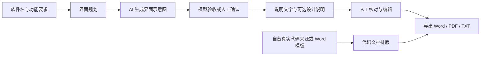

# 软件指南生成器 · Manual Studio

**把软件说明材料的规划、配图、文字编辑和文档导出放进一个 macOS 工作台。**

输入软件名称和功能要求，规划界面，调用模型生成界面示意图与说明文字，再逐项核对、修改并导出 Word / PDF / TXT。支持单个项目精修，也支持批量生成、批量更新代码材料与导出。

[下载原生版](https://github.com/deepfry666/manual-studio/releases) · [首次使用](docs/原生版快速入门.md) · [原生版开发与更新记录](native/README.md)

> **先了解边界：** 应用中称为「截图」的生成图片是 AI 生成的界面示意，不是对实际运行软件的自动截屏，也不能证明功能已实现。文字、日期、代码来源与导出材料都需要人工核验。用于软件著作权登记时，应以真实软件及有效材料要求为准，本工具不保证审核通过。

## 能做什么

| 工作 | 功能 |
| --- | --- |
| 从需求到初稿 | 规划界面，生成配图，使用看图模型验收并抄录图中文字，撰写说明，可附加设计说明 |
| 逐屏修改 | 编辑页把图片和文字放在一起；支持单屏改图、只改文字、查看与恢复历史版本 |
| 整理交付文件 | 导出指南 Word / PDF / TXT；配置自己的代码来源后生成代码文档 |
| 批量处理 | 批量新建、按名单选择、只重写文字、全部重做、批量更新代码材料与导出 |
| 追踪过程 | 查看项目进度、调用记录和统计；「已提交」标记让项目保持只读 |

### 从输入到交付

以下是**工作流程示意，不是应用截图**；模型验收不替代人工检查。



流程摘要：填写需求 → 规划 → 生成图片 → 验收 → 撰写文字 → 人工核对 → 导出。代码材料来自用户提供的代码来源，不是根据软件名生成实际软件。

## 开始使用

### 先准备

- **Mac：** 当前 App 最低支持 **macOS 26**，构建脚本产物为 arm64 + x86_64 通用包；不是 Windows 或 Linux 应用。
- **模型服务：** 自备可用的生图线路和大模型 API 配置。规划、文字生成和看图验收的能力要求不同，具体见[入门说明](docs/原生版快速入门.md)。
- **LibreOffice：** 指南 PDF 转换需要另外安装；Word 代码模板模式的代码 PDF 使用 macOS 原生排版。导入旧 `.doc` 模板也需要 LibreOffice。
- **代码与字体：** 代码模板不随安装包提供；商业字体也不随包提供，需自行取得使用授权或使用可用替代字体。

### 做第一个项目

1. 在 [Releases](https://github.com/deepfry666/manual-studio/releases) 下载原生版 ZIP，解压后将 App 放进「应用程序」。当前构建采用 ad-hoc 签名，首次打开可能被 macOS 安全机制拦截，请先核实下载来源。
2. 在「模型与线路」配置生图线路、大模型和各步骤使用的模型；在「设置 → 通用」确认工作区及 LibreOffice 检测结果。
3. 需要代码材料时，在「设置 → 代码模板」加入自己的模板，并检查「设置 → TXT」中的环境与代码字段。
4. 「新建项目」填写软件名、截图数、重点功能和日期。初次使用建议先做一个项目，并打开规划确认，检查后再继续。
5. 在「编辑」逐屏核对图片和说明，再到「交付」检查、打开或导出文件。

完整的配置、费用和故障排查见 **[原生版快速入门](docs/原生版快速入门.md)**。

## 费用与数据

- 下载应用不包含模型额度。生成图片、模型测试、规划、验收、重写文字等操作可能由所选服务商计费。
- 自动重试、验收不通过后的重生、超时补发可能增加调用次数；取消或丢弃返回结果不代表服务商不会收费。建议先用单个项目确认效果和费用，再提高并发。
- 只更新代码材料不调用 AI，但仍需本地排版与文件处理。
- 项目默认保存在 `~/Desktop/软件指南生成`。原生版设置、调用记录和密钥等数据位于 `~/Library/Application Support/软件指南生成器（原生版）`。
- AI 步骤会把所需文本或图片发送给你配置的模型服务商。这不是完全离线工具，请勿在未获授权时输入客户资料、个人敏感信息或机密内容。
- 不要把 API 密钥、应用数据目录或含私人信息的调用日志提交到 GitHub。反馈问题前先脱敏。

## 当前版与历史版

| 版本 | 代码位置 | 状态 |
| --- | --- | --- |
| **macOS 原生版** | [`native/`](native/) | SwiftUI，当前唯一维护和发版的版本，支持在线更新 |
| Electron 旧版 | `electron/`、`core/`、`web/` | 定档在 `electron-v0.1.0-final`，不再修改或发版，仅保留作对照 |

- 原生版与 Electron 旧版共用项目工作区，但应用数据分开保存。导入旧版前先备份，避免两版同时修改同一项目。
- [旧版使用说明](docs/使用说明.md)仅适用于 Electron，菜单、模板规则和数据存储方式不能直接套用到当前版。
- 原生版提示词、Word 固定部件和对照测试数据由 `native/scripts/` 从旧代码生成，旧版代码保留作只读来源。

## 从源码构建

依照当前仓库的[原生版构建说明](native/README.md)，需要 **Xcode 27（macOS 27 SDK）**；App 的最低运行版本为 macOS 26。核心 Swift Package 的最低平台声明不等于 App 的系统要求。

在仓库根目录运行：

```bash
cd native
scripts/build-app.sh --test --zip
```

脚本先运行 StudioCore 测试，再构建和打包；产物位于 `native/dist/`。也可用 Xcode 打开 `native/ManualStudio.xcodeproj` 开发。此路径不需要先运行旧 Electron 版的 `npm start`。

## 文档导航

- [原生版快速入门](docs/原生版快速入门.md)：安装、模型配置、首个项目、费用与核验清单。
- [原生版说明](native/README.md)：构建、数据迁移、功能演进与版本记录。
- [产品说明](PRODUCT.md)：使用场景与交互原则。
- [GitHub Releases](https://github.com/deepfry666/manual-studio/releases)：安装包与发布说明。
